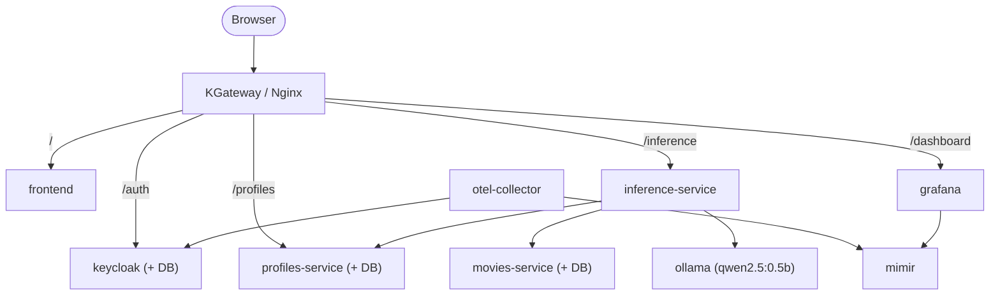

# AGI Project

Microservices movie recommendation platform with OIDC auth, LLM inference, and Kubernetes observability.

## Architecture



| Service | Stack | Port / Path | Role |
| :--- | :--- | :--- | :--- |
| `frontend` | React, Vite, Nginx | `:5173` / `/` | SPA UI; reverse-proxies backend APIs in Compose, routed via KGateway in K8s. |
| `keycloak` | Keycloak `26.7.3`, Postgres `18.6`, Terraform | `:8080` / `/auth` | OIDC provider (`agi-project` realm, `agi-web` PKCE client, `profiles-api`, `movies-api`, `inference-api` audiences). |
| `profiles-service` | Flask, Postgres `18.6` | `:3000` / `/profiles` | User profile & watch history CRUD. |
| `movies-service` | Flask, Postgres `18.6` | `:3001` / *(internal)* | Movie catalog seeded from `services/movies-service/data/movies.csv.gz`. |
| `inference-service` | Flask, Ollama `0.35.0` (`qwen2.5:0.5b`) | `:8000` / `/inference` | Queries `movies-service` (up to 30 candidates), filters watched/disliked genres in Python, and prompts Ollama for structured JSON ranking (`{"recommendations": [...]}`). |
| `kgateway` | K8s Gateway API (`v1.6.1`), KGateway `2.4.5` | NodePort `:30080` (`:80` on Kind) | K8s ingress routing. |
| `observability` | OTel Collector, Mimir, Grafana, Terraform | `/dashboard` | Metrics scraping, long-term storage, and auto-provisioned Grafana dashboards. |

### Configuration & Build Notes
- **LLM Model**: Set via `INFERENCE_OLLAMA_MODEL=qwen2.5:0.5b` in `.env` (~398 MB). Propagates to `inference-service` (`MODEL_NAME`), Docker Compose (`ollama-init.sh`), and K8s (`configmap.yaml`, `ollama/values.yaml`).
- **Env Files**: `just` requires `ENV=<local|kind|cloud>` and loads `.env`, `.env.$ENV`, `.env.kube` (sets `KUBECONFIG=$(pwd)/.kube/gcp-config` for `kind`/`cloud`), `.env.secrets` (generated by `just init`), and `.env.disks` (generated by GCP Terraform).
- **Multi-Arch**: `ollama/ollama` and GGUF weights run natively on ARM64 and x86_64. When building `agi-*` images on Apple Silicon for x86_64 GCP nodes, prefix builds with `DOCKER_DEFAULT_PLATFORM=linux/amd64`.

## Prerequisites

`docker` (with `compose`), `just`, `terraform`, `openssl`, `envsubst` (`gettext`), `jq`.
- **K8s (`kind` / `cloud`)**: `kubectl`, `helm`, `kind`
- **Cloud (`cloud`)**: `ansible` (or use the Dockerized `mgmt` container)

---

## Runbook

### 1. Local (Docker Compose)

```bash
ENV=local just init       # Generate .env.secrets and render realm-export.json
ENV=local just build      # Build agi-* images and pull ollama
ENV=local just local-up   # Boot Keycloak, apply Auth Terraform, start all services
```

- **Endpoints**: Frontend `http://localhost:5173` | Keycloak `http://localhost:8080` (`admin` / password in `.env.secrets`)
- **Re-seed movies**: `ENV=local just seed-movies` (or `seed-movies-reload` to drop & reload)
- **Teardown**: `ENV=local just local-clean` (or `local-destroy` to also delete `.env.secrets`)

### 2. Local Kubernetes (Kind)

```bash
ENV=kind just init
ENV=kind just build
ENV=kind just kind-up     # Creates cluster-psia2026, loads images, runs kube-deploy
```

- **Existing Kind cluster kubeconfig fix**: If `cluster-psia2026` existed prior to `.kube/gcp-config`:
  ```bash
  kind export kubeconfig --name=cluster-psia2026 --kubeconfig=.kube/gcp-config
  ```
- **Deploy individual services**: `ENV=kind just kube-deploy-<movies-service|inference-service|profiles-service|frontend>`
- **Endpoints**: Frontend `http://localhost/` | Keycloak `http://localhost/auth` | Grafana `http://localhost/dashboard`
- **Teardown**: `ENV=kind just kind-clean` (or `kind-destroy`)

### 3. Cloud Kubernetes (GCP)

1. Place GCP SA key at `infra/environments/dev/gcp/credentials.json` and set `GCP_PROJECT_ID = "<project-id>"` in `infra/environments/dev/gcp/terraform.tfvars`.
2. Initialize and build `linux/amd64` images:
   ```bash
   ENV=cloud just init
   DOCKER_DEFAULT_PLATFORM=linux/amd64 ENV=cloud just build
   ```
3. Provision GCP infra (Terraform), bootstrap K8s + upload images (Ansible), install GCE PD CSI driver, and deploy manifests:
   ```bash
   # Via mgmt container:
   ENV=cloud just mgmt-up
   ENV=cloud just cloud-infra-init
   ENV=cloud just cloud-up

   # Or directly on host:
   ENV=cloud just cloud-infra-init local
   ENV=cloud just cloud-up local
   ```
- **Endpoints**: `http://<MASTER_EXTERNAL_IP>:30080/` (`/`, `/auth`, `/dashboard` — IP is written to `.env.cloud`)
- **Teardown**: `ENV=cloud just cloud-clean` (keeps disks) | `ENV=cloud just cloud-destroy` (destroys all infra, disks, and secrets)

---

## Troubleshooting

### Common Browser Issue: Insecure `IP:PORT` Access

Browsers block Web Crypto API (required by Keycloak PKCE) on plain HTTP `IP:PORT` origins. In Chrome:
1. Open `chrome://flags/#unsafely-treat-insecure-origin-as-secure`
2. Enable **Insecure origins treated as secure** and add `http://<MASTER_EXTERNAL_IP>:30080`
3. Relaunch Chrome.